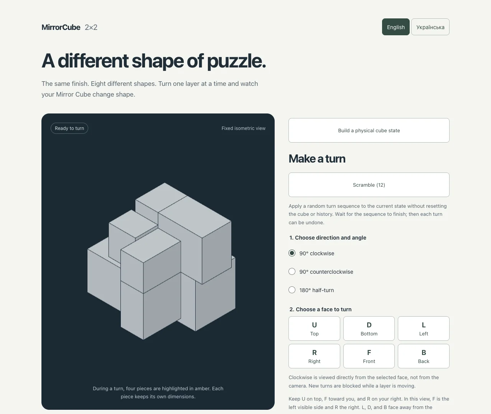

# MirrorCube

An interactive guide to solving a **2×2 Mirror Cube**, with an exact 3D model and step-by-step animated instructions in **English and Ukrainian**.

**[Open MirrorCube](https://mirror-cube.netlify.app/)**



## What you can do

- Turn and scramble the virtual cube, with move history and animated undo.
- Recreate a physical state by placing eight distinct pieces and choosing their orientations.
- Compare exact dimensions using edge rulers, eight camera presets, and mouse/one-finger free inspection.
- Find a solution without supplying the moves that produced the state.
- Follow animated steps, navigate forward/backward, replay a demonstration, or reset.

Puzzle state and solution search stay in the browser. Search runs in a Web Worker; there is no application backend, account system, or analytics integration.

## Run locally

Use **Node.js 24.15+ within the 24.x release line** and npm. See `package.json` for all supported versions.

```sh
npm ci
npm run dev
```

Open the local address printed by Vite.

```sh
npm test           # Automated checks
npm run build     # Type checking and production build
npm run preview   # Serve dist locally
```

## Scope and limitations

- The app supports one fixed 50 mm model: X layers 22/28 mm, Y 20/30 mm, and Z 33/17 mm (back/front). Other Mirror Cubes may not match. See [geometry and architecture](docs/architecture.md).
- A valid entered state is mechanically reachable, but still needs to match your physical cube.
- A modern browser with WebGL 2 is required. Reloading clears the puzzle, history, draft, solution, and language selection.
- Photo input is not available. Offline photo tools are maintained separately on [`feat/offline-photo-tools`](https://github.com/deysan/mirror-cube/tree/feat/offline-photo-tools) and are not part of this app build.

## Documentation

- [User guide](docs/usage.md)
- [Geometry, architecture, and state boundaries](docs/architecture.md)
- [Solver design](docs/solver.md)
- [Development and verification](docs/contributing.md)
- [Security and privacy](docs/security.md)
- [Deployment and hosting](docs/deployment.md)
- [Roadmap](docs/roadmap.md)

Built with React, TypeScript, Vite, Three.js, and React Three Fiber.

## License

No license has been selected.
